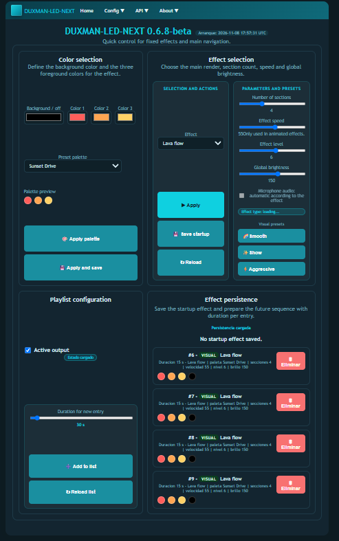
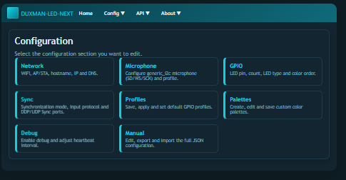
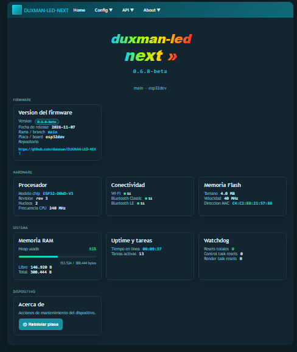

# 💡 DUXMAN LED — Firmware Modular de Iluminación para ESP32

[](CHANGELOG.md)
[](https://platformio.org/)
[](https://www.espressif.com/)
[](#arquitectura-tecnica)
[](LICENSE)

**DUXMAN LED** es un firmware de código abierto para microcontroladores **ESP32**, **ESP32-C3** y **ESP32-S3** diseñado para el control profesional, modular y de alto rendimiento de tiras LED digitales direccionables (WS2812B, SK6812, WS2811, WS2815 y compatibles). 

Diseñado bajo la filosofía de **cero dependencia de la nube**: el microcontrolador actúa como una estación autónoma completa con su propio servidor web asíncrono, panel de control responsivo servido desde LittleFS, análisis de audio en tiempo real por micrófono I2S, integración directa con **LedFx (DDP/E1.31)** y sincronización en cluster multi-nodo con reloj de fase compartido.

---

## 📸 Interfaz de Control en Tiempo Real

El firmware incluye una aplicación web completa y responsiva alojada en la memoria flash interna del ESP32, accesible al instante desde cualquier navegador móvil o de escritorio sin necesidad de instalar apps adicionales:



*Panel Home: control instantáneo de encendido, brillo maestro, selección de efecto, velocidad, nivel, paleta de colores cromática, transiciones suaves, modo audio reactivo y secuenciador automático de escenas.*

---

## 🌟 Características Principales

### ⚡ 1. Arquitectura FreeRTOS Dual-Core a ~62.5 FPS
- **Separación total de tareas:**
  - `controlTask` (**Core 0**, cadencia ~10 ms): atiende peticiones HTTP asíncronas, API REST, Wi-Fi, mDNS, muestreo de audio I2S, sincronización y vigilancia watchdog.
  - `renderTask` (**Core 1**, cadencia ~16 ms): cálculo matemático de efectos, mezcla de gradientes, limitación de corriente por software y refresco DMA a los LEDs.
- **Cero bloqueos ni parpadeos (glitch-free):** Las transferencias de red o consultas web no detienen ni ralentizan el refresco de los píxeles.

### 🌐 2. Web UI Autónoma Embebida en LittleFS
- Servida directamente por el microcontrolador mediante archivos HTML5, CSS y JavaScript modernos y ligeros.
- Funciona tanto en **modo Punto de Acceso (AP)** si estás fuera de casa o en instalaciones aisladas, como en **modo Cliente (STA)** conectado a tu router Wi-Fi.

### 🎵 3. Iluminación Audio-Reactiva con Micrófono I2S
- Soporte nativo para micrófonos digitales I2S (INMP441, SPH0645, etc.).
- Procesamiento acústico con eliminación de offset DC, suelo de ruido adaptativo y AGC dinámico.
- Catálogo de efectos reactivos dedicados: ecualizador gráfico por bandas, detección de beats (graves), pulsos de choque y cintas trigonométricas reactivas.

### 🎛️ 4. Streaming en Red con LedFx (DDP y E1.31 / sACN)
- **Protocolo DDP (Distributed Display Protocol):** Puerto 4048 UDP para recibir tramas de píxeles a más de 68 FPS con latencia imperceptible.
- **Protocolo E1.31 / sACN:** Puerto 5568 UDP para universos y canales DMX sobre IP.
- **Aislamiento inteligente en modo cliente:** Cuando el ESP32 recibe streaming activo desde LedFx o desde un nodo maestro, suspende automáticamente el micrófono ambiente local y los efectos programados para que la tira responda exclusivamente a la música sin interferencias. En modo servidor/master, el micrófono y los efectos permanecen 100% operativos.

### 🛡️ 5. Gestión de Potencia Inteligente (Power Management)
- Estimador de consumo en miliamperios (mA) y corrección de caída de voltaje por software.
- Escalado automático de brillo si la escena sobrepasa el límite físico configurado para proteger la fuente de alimentación y evitar sobrecalentamientos.

### 🎨 6. Paletas de Color y Perfiles de Hardware en Caliente
- Catálogo de paletas integradas por estilos (`warm`, `cold`, `neon`, `pastel`, `high-contrast`, `party`).
- Editor de paletas de usuario con guardado permanente en LittleFS.
- Hasta 8 perfiles de hardware que permiten reconfigurar pines, cantidad de LEDs y orden de color (RGB, GRB, RGBW) sin reiniciar el dispositivo.

### 🔌 7. API REST v1 y Serial Idénticos
- Control programático total mediante endpoints HTTP JSON y comandos por puerto serie equivalentes.
- Especificación OpenAPI / Swagger 3.0 embebida en `/api/v1/openapi.json`.
- Integración transparente con Home Assistant, Node-RED, scripts en Python o Postman.

---

## 🖼️ Galería de la Web Embebida

| Configuración del Dispositivo | Explorador de API REST |
|:---:|:---:|
|  |  |
| *Gestión de Wi-Fi, GPIOs, audio I2S, protocolos sync y perfiles de corriente.* | *Explorador OpenAPI embebido con documentación de endpoints y payloads.* |

| Documentación y Ayuda en Firmware | Información del Sistema y Versión |
|:---:|:---:|
|  |  |
| *Guía de conexión física, esquemas de pines y solución de dudas frecuentes.* | *Telemetría de chips, particiones flash, RAM libre y créditos open source.* |

---

## 🎨 Catálogo de Efectos Integrados

### Efectos Visuales
- **Lava Flow:** Flujo térmico orgánico con degradados cálidos continuos.
- **Polar Ice:** Ondas glaciares frías con transiciones suaves en tonos cian y azul.
- **Gradient Meteor:** Estelas de luz que recorren la tira desvaneciéndose en color.
- **Scanning Pulse:** Pulso rítmico oscilante bilateral estilo escáner.
- **Triple Chase:** Tres focos lumínicos en movimiento relativo a distintas velocidades.
- **Breath & Blink:** Respiración y parpadeo tanto en color fijo como en gradiente.
- **Random Color Pop:** Destellos cromáticos aleatorios sobre fondo atenuado.
- **Diagnostic:** Verificación de orden de color RGB/GRB y píxeles defectuosos.

### Efectos Audio-Reactivos (Micrófono I2S)
- **Audio Neon EQ:** Ecualizador gráfico reactivo a medios y agudos.
- **Audio Spectrum:** Espectro de frecuencias dinámico proyectado a lo largo de la tira.
- **Audio Pulse:** Impulso de brillo y onda de choque sincronizada con los golpes de graves.
- **Spectrum Chase:** Desplazamiento dinámico guiado por el compás rítmico.
- **Audio Rainbow Wave:** Arcoíris reactivo cuya amplitud responde al volumen sonoro.
- **Bouncing Physics:** Simulación gravitatoria de partículas elásticas impulsadas por la música.
- **Stellar Twinkle:** Centelleo estelar modulado por energía acústica.
- **Trig Ribbon:** Modulación trigonométrica de color por intensidad sonora.

---

## 📋 Hardware Soportado

| Perfil PlatformIO | Placa MCU | Pin LED por Defecto | LEDs Iniciales | Arquitectura |
|---|---|:---:|:---:|---|
| `esp32c3supermini` | ESP32-C3 DevKitM-1 / SuperMini | GPIO 8 | 60 | RISC-V 32-bit (Single-Core 160MHz) |
| `esp32dev` | ESP32 NodeMCU / DevKit v1 | GPIO 5 | 60 | Xtensa LX6 (Dual-Core 240MHz) |
| `esp32s3` | ESP32-S3 DevKitC-1 | GPIO 48 | 60 | Xtensa LX7 (Dual-Core 240MHz + Vector) |

---

## 🚀 Inicio Rápido (Quickstart)

### 1. Compilación y Subida con PlatformIO

Puedes compilar y subir el firmware utilizando PlatformIO CLI o el script automatizado para Windows:

```powershell
# Compilar según tu placa
pio run -e esp32dev
pio run -e esp32c3supermini
pio run -e esp32s3

# Subir firmware por puerto USB
pio run -e esp32dev -t upload

# O usando el script auxiliar con autodetección de puerto COM:
.\tools\flash.ps1 -Profile esp32dev -Action upload
```

### 2. Subida del Sistema de Archivos (LittleFS)
Para cargar las páginas HTML/CSS/JS de la interfaz web en la memoria Flash del ESP32:

```powershell
pio run -e esp32dev -t uploadfs
```

### 3. Conexión de Hardware Segura
- **Alimentación:** Conecta la tira LED (5V o 12V según modelo) a una fuente de alimentación adecuada.
- **Masa Común:** Conecta siempre el cable **GND de la fuente** al pin **GND del ESP32**.
- **Línea de Datos:** Conecta la línea de datos (DIN) al GPIO correspondiente (se recomienda resistencia de 330Ω en serie y condensador de 1000µF en la entrada de corriente).

### 4. Primer Acceso a la Web UI
1. Al arrancar por primera vez, el ESP32 genera una red Wi-Fi propia llamada `duxman-led-01-ap`.
2. Conéctate a esa red desde tu teléfono u ordenador.
3. Abre tu navegador e ingresa a: **`http://192.168.4.1`**.
4. Ve a la pestaña **Configuración > Red** para enlazar el dispositivo a tu red Wi-Fi doméstica.

---

## 🧪 Pruebas Automatizadas de API y Monitor Serie

El proyecto cuenta con suites de pruebas automatizadas de extremo a extremo que validan el 100% de los endpoints REST del firmware y emiten marcas en la consola serie:

- **Suite en Python:** [tools/test-api.py](tools/test-api.py) (sin librerías externas, sólo Python estándar).
- **Suite en PowerShell:** [tools/test-api.ps1](tools/test-api.ps1).

```powershell
# Ejecución interactiva guiada (pausas para Web UI y LedFx):
python tools/test-api.py --url http://192.168.0.56

# Ejecución desatendida (CI/CD):
python tools/test-api.py --url http://192.168.0.56 --non-interactive
```

Todo el tráfico de pruebas y del monitor serie se archiva automáticamente en la carpeta `log/`:
- `log/test-api-latest.log`: Registro completo de peticiones, respuestas y aserciones.
- `log/device-monitor-latest.log`: Registro de la consola serie con marcas de tiempo, FPS y memoria RAM libre.

---

## 📡 Resumen de API v1

Base HTTP: `http://<ip-dispositivo>/api/v1`

| Grupo | Método | Rutas Principales | Descripción |
|---|:---:|---|---|
| **Estado** | `GET / PATCH` | `/state` | Consulta y cambio de brillo, colores, efectos y velocidad. |
| **Depuración** | `POST / GET` | `/marcalog`, `/debug/log` | Inyecta marcas de log directas a la consola serie del ESP32. |
| **Sistema** | `GET / POST` | `/diag`, `/hardware`, `/metrics`, `/release`, `/system/restart` | Diagnósticos de memoria heap, FPS en Core 1, reinicio y hardware. |
| **Configuración** | `GET / PATCH` | `/config/{network,gpio,microphone,general,debug}`, `/config/all` | Configuración modular o exportación/importación completa en JSON. |
| **Sincronización**| `GET / PATCH` | `/sync/state`, `/sync/config`, `/sync/mode`, `/sync/connected` | Control de receptor LedFx (DDP/E1.31) y clusters sincronizados. |
| **Perfiles** | `GET / POST` | `/profiles`, `/profiles/{save,apply,default,delete,clone}` | Gestión de configuraciones de hardware en caliente sin reinicio. |
| **Paletas** | `GET / POST` | `/palettes`, `/palettes/{apply,save,delete}` | Selección y creación interactiva de paletas cromáticas de usuario. |
| **Efectos** | `GET / POST` | `/effects`, `/effects/sequence/{add,delete}` | Catálogo de efectos y programación de secuencias temporizadas. |

Especificación Swagger/OpenAPI 3.0 completa disponible en el propio firmware: **`GET /api/v1/openapi.json`**.  
Documentación extendida en [docs/wiki/API-v1.md](docs/wiki/API-v1.md).

---

## 🏗️ Arquitectura Técnica

- **Framework:** Arduino ESP32 core sobre ESP-IDF con FreeRTOS.
- **Motor de Render:** Drivers modulares intercambiables:
  - `NeoPixelBus` (Makuna): Driver principal por DMA / I2S / RMT para máximo refresco sin interrupciones.
  - `FastLED`: Backend alternativo compatible.
  - `Digital`: Salida digital simple para relés o indicadores.
- **Persistencia Flash:** LittleFS con scheduler diferido que agrupa mutaciones en RAM y las escribe espaciadas para garantizar larga vida útil a los sectores Flash.
- **Sincronización:** Stack UDP con DDP (4048), E1.31 (5568) y cluster interno (`_duxsync._udp`).

---

## 🤝 Agradecimientos Especiales y Fuentes de Inspiración

Este firmware se nutre de la generosidad y el conocimiento compartido por grandes pioneros de la iluminación interactiva y el software libre:

- **[WLED (kno.wled.ge)](https://kno.wled.ge/):** Un agradecimiento muy especial e infinito a **Christian Schwinne (Aircoookie)** y a toda la comunidad de WLED. Su trabajo pionero, su código abierto y su documentación exhaustiva han sido el faro principal para comprender este maravilloso mundo de luz, color y firmware.
- **[LedFx (ledfx/ledfx)](https://github.com/ledfx/ledfx):** A todo el equipo de LedFx por su impresionante software de audio reactivo y su apoyo a la sincronización en tiempo real.
- **Librerías Clave:** A los mantenedores de `NeoPixelBus` (Makuna), `FastLED`, `ArduinoJson` (Benoît Blanchon), `ESPAsyncWebServer` y la plataforma `PlatformIO`.

---

## 📚 Documentación y Recursos

- [Memoria Técnica del Proyecto](docs/MEMORIA_PROYECTO.md)
- [Esquema de Configuración JSON](docs/wiki/Configuration-Schema.md)
- [Guía de Compatibilidad de Sincronización](docs/wiki/Sync-Compatibility.md)
- [Colección de Pruebas Postman](docs/postman/README.md)
- [Checklist de Release](docs/RELEASE_CHECKLIST.md)

---

## 📄 Licencia

Este proyecto está licenciado bajo la licencia de código abierto **Apache License 2.0**. Consulta el archivo `LICENSE` para más detalles.
